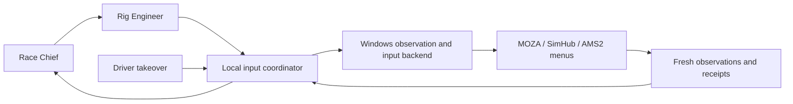

# ORC input orchestration

The synthetic coordinator journal and a read-only Rig Engineer definition are
implemented. The Windows pilot uses SAS v0.2.0 for the Chief-owned relationship,
handler review and explicit reporting. The local coordinator owns menu input.
Live adapter deployment, live recovery and faster session loading remain
unverified. The scope is arrival preparation.

The Chief should accept an intention, prepare the installed tools and correct
simulator session, verify readiness and hand control to the driver. ORC should
own that coordination, its evidence and recovery. A particular computer-use
backend is an adapter, not the source of product state or driving authority.
Existing tools continue to follow their own approval and access boundaries;
this design is not permission to bypass them.

## Ownership and boundaries

The Chief owns intent and the final handoff. A Rig Engineer can observe state,
prepare a recipe and report exceptions after the durable engineering foundation
is proven. It submits bounded commands to one local input coordinator; it does
not independently operate the desktop. The coordinator owns admission, ordering,
deadlines, target checks and the result journal. A replaceable Windows backend
performs only admitted actions and reports observations.



Capture, fuel rules and radio remain independent of navigation and inference.
A model/network failure must stop new menu actions without ending those services.
The first scope covers app preparation and simulator menus. Steering, throttle,
brake, force-feedback configuration, firmware, deployment and account operations
are outside that scope. A process being alive is not device or session readiness.

## Apply Standard Agent Specification deliberately

The [between-drive Rig Engineer](idle-rig-preflight.md) also uses this child
definition. Its local Pi Durable host persists scoped, read-only idle preflight
reports for the Chief. It monitors Steam, Windows USB devices and the saved AMS2
control profile independently of the synthetic input coordinator.

Use the versioned **SAS v0.2.0** definitions as the agent boundary. The following
is ORC's proposed mapping, not a declaration that the current runtime conforms.

| Concern | Spec basis | ORC application |
| --- | --- | --- |
| Specialist identity and ownership | Declared subagent relationships, stable child references and persistent threads | One Chief-owned Rig Engineer relationship with an instance cap; reuse its identity across work sessions. Thread identity never grants desktop ownership. |
| Callable capabilities | Typed function tools with validated arguments and persisted results | Narrow observe, propose, submit, inspect and cancel operations; no arbitrary shell/code argument for input. Explicit tool dependencies. |
| Command intake | A handler can own a side without a model turn | A short adapter can validate/enqueue an ORC command and return. It must not hold its delivery slot while waiting for the whole menu sequence. |
| Durable state | Per-thread state and ordered messages | Store recipe references, decisions and correction history in the appropriate thread; retain physical action receipts in the local coordinator journal. |
| Deferred work | Scheduled effects run outside immediate conversation processing | Optional preparation reminders or review notifications. A delayed effect never retains permission to inject input. |

SAS places relationships on the owning agent side and preserves children beyond
session end. That fits durable specialist continuity. ORC's desktop owner is a
separate resource claim, not a consequence of the relationship or its instance
limit. [Subagents](https://standardagentspec.org/0.2.0/specification/subagents/).

Function tools validate schemas, execute local calls sequentially and persist
results/errors. ORC additionally serializes every physical input request across
all specialist threads. [Tools](https://standardagentspec.org/0.2.0/specification/tools/).

Handler delivery is once per persisted message, ordered within a thread, without
automatic redelivery after failure. This does not establish that a click occurred
exactly once across a process crash. Keep handler intake short and use later
status messages for completion. [Handlers](https://standardagentspec.org/0.2.0/specification/handlers/).

The spec permits concurrency across threads and defines thread persistence and
termination. ORC must separately implement desktop exclusion, immediate takeover
and physical-outcome reconciliation. [Runtime](https://standardagentspec.org/0.2.0/infrastructure/runtime/).
Effects preserve scheduled arguments and may outlive the conversation; treat
them as requests requiring fresh admission, never delayed keystrokes.
[Effects](https://standardagentspec.org/0.2.0/specification/effects/).

Pin the spec and chosen runtime versions and publish a tested capability matrix.
Pi Durable remains a candidate; its recovery/replay behavior must be reconciled
with SAS delivery requirements and ORC's physical side effects. Do not claim full
SAS support from a lifecycle subset or use an importable package as conformance
evidence. Subscription inference and consent remain separate verified capabilities.

For each new specialist or adapter, document the pinned spec/runtime versions,
declared relationships, typed capabilities, durable state, ordering, cancellation
and recovery behavior before connecting it to the rig. Identify each capability
as proposed, implemented, tested or unsupported, with evidence for tested claims.
Reject unsupported definitions explicitly instead of silently approximating them.
Reuse SAS concepts where their semantics fit; keep ORC-specific permission,
freshness, physical outcome and driver-takeover contracts in the local coordinator.
Capture, fuel supervision and radio scheduling remain local operational components;
they do not require an agent turn for every event. This adoption policy does not
select a runtime or authorize its deployment.

### Adapter review record

Keep one versioned record with each specialist/adapter implementation. This is an
ORC review format, not a SAS manifest or a substitute for runtime validation:

| Field | Required content |
| --- | --- |
| Identity | Role, definition/source hash, owning relationship and persistent instance reference. |
| Compatibility | Pinned SAS version, runtime/package version and supported subset; name unsupported features explicitly. |
| Capabilities | Typed tool schemas, declared dependencies and the local gateway operations each tool can reach. |
| State | Thread-owned memory versus coordinator-owned receipts; artifact references and retention/privacy rules. |
| Lifecycle | Ordering, cancellation, restart and uncertain-effect reconciliation, including which operations must never replay. |
| Authority | Who may grant/revoke input, generation/deadline binding and the independent driver-takeover path. |
| Evidence | Exact source/runtime tested, command, exit code, private artifact reference and PASS/FAIL/NOT RUN per capability. |
| Release | Proposed/implemented/tested/deployed status, unresolved gates and the scope of any rollout authorization. |

Review capability by capability: a synthetic PASS does not make a live capability
tested, and tested does not mean deployed. Keep provider/subscription access as a
separate verified capability; a spec-compatible definition cannot establish it.

### Rig Engineer receipt review

The [definitions](../agents/rig-preparation/definitions.mjs) use the official
`@standardagents/spec` SDK 0.41.14, whose `SPEC_VERSION` is 0.2.0. The driver-facing
Chief owns one nonblocking Rig Engineer relationship. A SAS handler backs the
Rig Engineer's side A for this review. A parent message arrives as a user message,
and the handler reads the receipt directly in one turn without a model round trip.
It explicitly reports to the parent through `stopSession`, which closes the
review session and leaves the child thread addressable.
[Handlers](https://standardagentspec.org/0.2.0/specification/handlers/).
[Parent messaging](https://standardagentspec.org/0.2.0/specification/threads/#9-3-parent-messaging).

Send the selected command ID and fingerprint as a JSON object in each
`subagent_message` request. A review request belongs to the current attempt.
SAS creation arguments persist across later sessions and are suited to context
that remains valid for the life of a child. The Chief correlates the report with
its outstanding request and verifies current rig evidence before handoff.
[Subagent messaging and invocation arguments](https://standardagentspec.org/0.2.0/specification/subagents/#5-lifecycle-tools).

| Capability | Evidence and limits |
| --- | --- |
| Composition | SDK validation passes for both definitions. The Windows Pi probe verifies one owned child per parent store, stable identity and persistence across reopen. Automatic parent activation remains unverified. |
| Scoped receipt lookup | The handler validates a bounded message containing exactly `command_id` and `fingerprint`. The host reader scopes lookup to the runtime's child thread ID and the Chief's selected attempt. A receipt must match both requested identities. The synthetic Windows gateway probe verified missing, queued, verified, unbound, wrong-child, wrong-owner and wrong-fingerprint cases. Inspection changed neither the journal nor simulated input. |
| Conversation close | The handler emits a bounded result. `observed` includes a sanitized receipt, `missing` includes a null receipt, and `receipt_unavailable` or `invalid_review` records a failed check. The Windows probe tests ordered invocation, interrupted delivery and failed storage during `stopSession`. |
| Authority and privacy | The handler receives a read-only host callback. The host must check scope and native gateway owner identity. The definition exposes no input tool or credentials. Input grant, dispatch, cancellation and takeover stay in the local coordinator. |

Reproduce the definition and handler checks with Node and npm:

```powershell
cd agents/rig-preparation
npm ci --ignore-scripts --no-audit --no-fund
npm test
```

The check uses a fixture reference for the Chief model. The ORC factory takes a
trusted `readReceipt(threadId, commandId, signal)` binding. Pass the abort signal
to the underlying I/O. If an asynchronous read stalls for two seconds, the
handler aborts it and reports `receipt_unavailable`. The deadline bounds the
lookup on a responsive event loop. It excludes committing `stopSession` and
delivering the parent report. The durable command stays in the local journal.
Release status is offline only.

A separate Windows probe uses Pi Durable 1.5.2 storage for this one handler
definition. The Chief-owned registry maps a stable SAS thread ID to a local Pi
conversation. Pi assigns numeric conversation IDs, which the host keeps
internal. The probe delivered two queued messages in order, persisted their
session outcomes and reused the same child after reopen. Different parent
stores received distinct child thread IDs. The host invokes the SAS handler
outside any replayable Pi task and persists its closure and pending parent
report together. No provider inference takes place.

Three process exits exercised the boundaries before invocation, during the
receipt read and after closure. The adapter delivers a still-queued message
on an explicit dispatcher call. An already claimed message with no confirmed
outcome becomes interrupted and requires a new request. A database write fault
during closure also leaves an interrupted message without a parent report.
This is conservative recovery across the interruption window. It can decline
to invoke a claimed message if the process stopped just before handler entry.
Full SAS exactly-once handler delivery, automatic parent activation, package
loading, boot/sleep behavior, power-loss durability and live handoff remain open.
[Handler delivery](https://standardagentspec.org/0.2.0/specification/handlers/#4-delivery-semantics).

The Chief-side Windows probe binds a particular review message to the selected
command ID and fingerprint. On a Chief update, its inbox consumer commits a
passive Pi history entry and acknowledges the pending report in one transaction.
Repeated consumption after restart produces one entry. A newer review supersedes
an older one even when both concern the same command. The Chief can still
inspect the old result in review history. An injected entry write fault left
the acknowledgement pending, and the Chief applied it once after reopen.

A stalled lookup previously held the handler's delivery slot and delayed newer
reviews. The Windows Pi probe now verifies that the deadline releases the slot,
the next queued review completes, and a late lookup result cannot replace either
report. Both outcomes survive reopen without rereading the receipt.

The synthetic gateway probe ran this full path for seven outcomes against the
local Input Gateway with a simulated backend. The same specialist thread
survived seven process lifetimes. The review history excludes unrelated Pi
entries and carries receipt evidence for the selected request. Current rig
readiness and handoff still require independent observations. Parent delivery
here is the deterministic inbox consumer called by the host. A SAS runtime
turn triggered by explicit notification remains unverified.
[Explicit parent notification](https://standardagentspec.org/0.2.0/specification/subagents/#6-4-child-parent-explicit-escalation).

## Local action contract

Each proposed command binds a unique command/attempt ID, requesting principal,
input-owner generation, recipe version/hash, typed action, target process creation
identity/window, fresh observation reference, preconditions, postcondition and
deadline. These are proposed ORC fields, not SAS-defined fields. The coordinator
validates them immediately before dispatch and retains both acceptance and actual
result. Repeating an ID with different content is refused; repeating the same
request returns its receipt rather than sending another input.

Only a verified owner in an explicitly permitted preparation/menu phase can act.
Human takeover revokes that generation, rejects its queued commands and stops
further input. The backend must release any keys/buttons it holds and report
whether release was confirmed. A revoked owner cannot regain control from a late
model response. Cancellation must reach this local path without waiting behind
a long agent handler or inference request. Measure takeover and key-release delay;
no numerical responsiveness guarantee is established yet.

Every action uses a fresh target observation. Ambiguous targets, changed focus,
unexpected modals, expired evidence, driving, unknown control ownership or backend
loss suspend the recipe. A time-out after dispatch is an unknown outcome: observe
the destination before any deliberate new attempt. Crash/restart preserves
prepared/dispatched/unconfirmed states; it cannot replay clicks automatically.
Starting a second coordinator requires actual old-owner reconciliation.

## Learning loading sequences

Observe the user's ordinary loading path in an announced, bounded demonstration.
Record semantic source/destination states, actual observed action or unknown,
context checks, timing, application version and evidence provenance. Do not infer
unseen clicks, record global typed content, or turn this into continuous desktop
surveillance. Selected-window images stay private and have an explicit retention
scope. Durable recipes use labels and postconditions; coordinates are disposable
products of the current observation.

Rehearse a proposed recipe offline against normal, wrong-session, modal, stale,
focus-loss and takeover traces. A confirmed destination can skip a redundant
navigation step. Recipe fuel values must come from the current reviewed stint
plan, not a historical demonstration. Device/output requirements come from the
private rig profile and explicit corrections. Final release still checks actual
car, track, mode, opponents, loaded fuel, capture and operational readiness.

## First implementation and acceptance

The initial Python coordinator and fake backend implement durable command receipts,
FIFO admission, duplicate/conflict checks, fresh observation gates and explicit
takeover. SQLite records dispatch before the simulated effect. Actual hidden test
processes die before and after that effect: recovery cancels queued work, retains
unknown dispatched outcomes and requires reconciliation without replay. A native
claim excludes cooperating synthetic owners across journals. It grants no actual
desktop authority; takeover is a software call, not hardware-input detection.
See the [journal contract](../schema/input_coordinator.md).

```powershell
.venv/Scripts/python.exe -B -m pytest tests/test_input_coordinator.py -q
```

There is no installed entry point, recipe resolver or real UI backend. Test callbacks
are trusted code, not a security sandbox. These checks establish neither physical
input delivery nor power-loss durability.

A private Pi Durable 1.5.2 boundary probe now exercises typed intake and cancellation
against the independent Python coordinator. It uses a faux model provider, generated
commands, actual hidden process exits and temporary authenticated loopback fixtures.
The agent can submit a pre-bound command but cannot grant permission or dispatch it.
This is a tested adapter prototype, not an installed service or SAS package loader.

| Capability | Observed result and limit |
| --- | --- |
| Argument validation | Missing, malformed and extra arguments produce runtime `invalid_arguments` before tool execution. A well-formed but unbound ID is refused separately. |
| Duplicate intake | Two tool calls retain one local command and no effect; a separate trusted dispatch produces the single simulated effect. |
| Interrupted unsafe tool | Process death before intake or after the receipt yields `interrupted` on recovery, without re-invoking the tool. Keep input intake explicitly `replay: unsafe`. |
| Replay-safe control | A deliberately replay-safe probe re-executes after death. The coordinator returns the existing cancelled receipt and never dispatches. This control is not the selected input policy. |
| Cancellation | Pi abort alone leaves the local command queued. The prototype requests local revocation before aborting the agent and retains both outcomes separately. Unconfirmed revocation stays unknown; an aborted turn is not proof of released input. |
| Evidence/storage failure | Local intake storage failure revokes local authority. A cancellation-log failure does not skip the agent abort and is retained as an evidence error. |
| Operational outcome | A completed model turn can contain a refused or expired command. Read the command receipt and tool diagnostics; model completion is not preparation success. |

Confidence is high for those synthetic observations. The temporary fixture is not
a production transport, principal authenticator, hardware takeover path or timing
guarantee. Local ownership survives the model-process failure in these tests; host
sleep, logon and power loss remain separate gates. The Pi adapter probe has no
SAS handler-backed sides, `uses` dependency enforcement, package loading or full
subagent lifecycle. The SAS receipt handler is a separate offline definition.

The repository now includes `InputGateway` and an optional loopback HTTP adapter.
The trusted Chief binds an exact command set to one principal, owner epoch, native
process identity and generation. An ephemeral bearer permits submit, inspect and
cancel; grant, dispatch and reconciliation remain in-process Chief operations.
The gateway snapshots commands, refuses caller/owner substitution and replaces
credentials after a new explicit generation. Restart restores no credential or
permission. A generation change is rechecked atomically with cancellation so a late
old request cannot revoke newer authority. See the [gateway contract](../schema/input_gateway.md).

The pinned Pi probe now also uses this actual repository gateway. It verifies
duplicate intake, local cancellation before agent abort, process-crash recovery,
principal refusal and rejection of a response with the wrong native owner identity.
Admission may have happened before a response was rejected: preserve its receipt
and reconcile rather than retrying for a green result. No real input is produced.

This is an opt-in synthetic interface, not a deployed desktop service. Caller names
are trusted-host assertions authenticated by bearer possession; OS/account identity,
endpoint discovery and a production credential handoff remain separate work.
The temporary fixture's old transport is retained only as baseline evidence.
ReviewedRecipe now loads an exact-byte Chief review and compiles semantic steps
from individually hashed, fresh synthetic observations. It checks application
version, desired context, current fuel-plan reference, prior command receipts and
target identity. Unknown selectors stop the sequence. Proposed paths remain
proposed; the code does not recognize controls from screenshots or record user
actions. Historical fuel amounts never become a current load recommendation.

The Chief can extend the same gateway binding after confirmed steps, using new
observations without re-granting permission or waiting for a model at every step.
An already-open destination skips redundant input, including when the old button
is absent. Every step remains separately journaled; cancellation and uncertain
effects still stop progression. See the [recipe contract](../schema/session_recipe.md).

The offline assessment separates navigation from fresh device, capture, fuel,
radio and handoff evidence. Missing or mismatched gates stay NOT RUN, explicit
failures remain FAIL, and even a complete rehearsal sets live_ready=false.
An actual read-only observer check exposed a boundary gap: the sampled accessibility
tree had no semantic app controls, and the selected-window screenshot included
unrelated overlapping UI. That capture is rejected as isolated app evidence. Native
target/focus and semantic state cannot be inferred from the generic window reference.
See the [observation boundary](input-observation-boundary.md) for verified limits and
the required request/response, scope and final-check contract. Keep runtime capability
declarations separate from ORC's resource authority, with no automatic deployment.

Then verify a single preparation path off-track: required applications, the
selected session and controls returned to the driver. Keep cold start, warm reuse,
loading, assistant delay, intentional wait and unknown time distinct. Retain failed
attempts and compare intention-to-loaded-session and seated-to-handoff against the
existing baseline. Use the next ordinary visit for confirmation; do not ask the
driver to repeat the full telemetry acceptance sequence.

The present evidence includes this synthetic journal, a private semantic-recipe
rehearsal, installed-app observations and a narrow durable-agent pilot. It does not establish a live ORC input
executor, recorded user-sequence recognizer, faster arrival, complete SAS runtime
or live navigation acceptance. See [arrival procedure](returning-to-the-rig.md).
