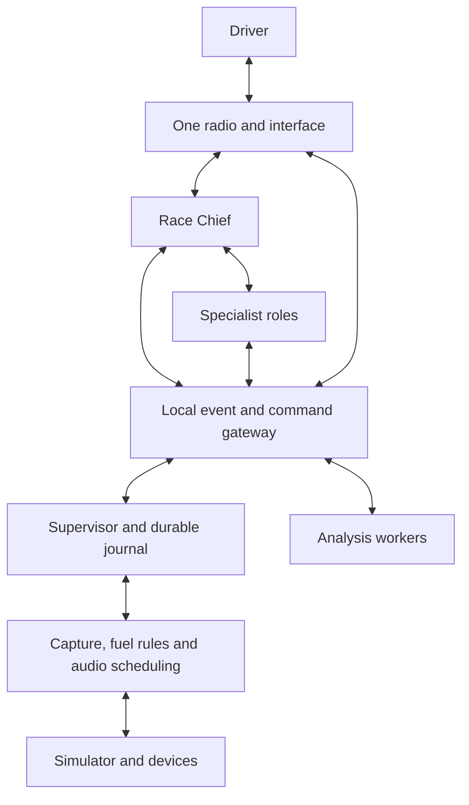

# Race chief product direction

Date: 2026-11-14. This design proposal records product requirements from the first live test. It separates accepted requirements, implemented behavior and open implementation choices. Confidence is high in the scoped live evidence; moderate in the proposed architecture; unknown in untested runtime and audio performance. This is not a release commitment.

## Purpose

Open Race Coach should own the whole rig visit: preparation, readiness, driving support, strategy, setup experiments, evidence and the next step. The driver drives and supplies intent, sensations and feedback. A capable principal agent acts as Race Chief, coordinates specialists, anticipates avoidable problems and remains accountable for the experience.

The goal is more useful driving and sustained improvement with less operational burden. The driver should feel that a competent team is paying attention, wants the visit to succeed and follows through. Care should be visible in timely help, remembered preferences, honest uncertainty, mistakes that change procedures, and respect for breaks.

The implemented post-session analysis remains the evidence foundation. This direction expands the historical [v0 scope](SPEC_v0.1.md); it does not weaken Recorded Session validity, artifact immutability or deterministic ownership of a Coaching Instruction.

## Status and authority

| Status | What belongs here |
|---|---|
| Implemented and exercised locally | AMS2 capture/validation/analysis; continuous private raw archive; driver clock and output reviews; high-resolution AMS2 Capture Time fix. See [live results](validation/ams2-2026-11-14.md) for exact scope and failures. |
| Accepted product requirements | A principal chief; durable specialist responsibilities; readiness and maintenance; setup/strategy support; continuous evidence including bad outcomes; driving/waiting measurement; timely live reactions; physically processed radio audio; authenticity through useful, accountable behavior. |
| Proposed implementation | Five-role initial team, native Windows host, local event journal and supervisor, one radio dispatcher, bounded model jobs, staged readiness/radio milestones. These are engineering recommendations, not a deployed system. |
| Candidate choices | Pi Durable versus a Codex app-server coordinator; model assignments; speech engines; native desktop Voice or Crew Chief integration; detailed latency and performance budgets. |
| Not established | Restart/logon durability, subscription/account entitlement, effective in-car audio, reliable caught-slide detection, coaching effectiveness, broad simulator compatibility or commercial distribution model. |

No durable specialist service or in-car audio pipeline was installed during the research. Today's live feedback was text in chat; its timely delivery to the driver was not verified. Coach Refinement was not run.

## What the first live work changed

| Observation | Requirement |
|---|---|
| Repeated scripted tests consumed driver attention and time | Prepare automated/replay checks first; prefer passive observation of ordinary driving; repeat a physical test only for a specific unresolved question. |
| Fuel exhaustion occurred outside a finalized recording | Keep independent capture active across recording boundaries, pits and breaks; supervise loaded fuel and return margin. |
| A canonical capture failed while the independent archive survived | Retain failed artifacts; recovery creates a new, provenance-labeled artifact rather than rewriting the original. |
| Windows clock, path length and status-file behavior caused failures | Host reliability is part of the product, including restart, disk and concurrent-reader behavior. |
| A helper stopped while primary capture continued | Separate capture from presentation and agent failure; expose degraded capabilities accurately. |
| A slowdown/stop did not prove a spin | Separate measured events, driver reports and causal hypotheses. |

The [sanitized evidence summary](validation/ams2-2026-11-14.md) is the source for results. Raw captures, absolute machine paths, participant details and private logs stay outside shared documentation.

## Principal and specialists

The Chief should use a strong reasoning model for long-term planning, tradeoffs and difficult diagnosis. Specialists need a stable role, evidence standard, memory, authority, wake trigger, budget and completion condition. A role can persist while its process is stopped or its model changes. Conversation history alone is not the authoritative record of facts or pending work.

The initial five-role split is a proposal:

| Role | Point of view | Responsibility | Boundary |
|---|---|---|---|
| Race Chief | Protect driving time and long-term progress | Goals, stint plan, priorities, delegation, decisions and driver relationship | Own team errors; reconcile advice before asking the driver to act. |
| Rig Engineer | Tested reliability before novelty | Version/configuration inventory, devices, readiness, maintenance and recovery | No disruptive changes while driving; verify effects and retain a recovery plan. |
| Telemetry Engineer | Evidence must survive and remain traceable | Coverage, clocks, units, boundaries, validation, recovery and storage | Mark unreliable evidence unusable; never change a failed artifact to make it pass. |
| Race Engineer | Finish the intended stint and identify one useful improvement | Fuel/strategy, setup experiments, consistency and supported coaching | Separate hypotheses from proven causes; preserve deterministic analysis authority. |
| Radio Engineer | Attention is scarce | Timing, priority, expiry, interruption, push-to-talk and delivery state | Suppress stale or intrusive messages; do not invent technique advice. |

Setup, strategy and coaching initially share the Race Engineer role. Split them only when their workload or conflicting objectives justify it. Different viewpoints should expose real tradeoffs, not manufacture arguments. The driver interacts with one coherent team rather than managing specialist chats.

## Durable operation and readiness

Keep capture, simple health/fuel rules and essential audio behavior in supervised local software. Models receive compact events and evidence references, then perform bounded work. A model/network/quota outage must not stop raw preservation or an already-supported local operational warning. This is a proposed reliability boundary, not current automatic fuel-call functionality.

Persist observations, proposals, decisions, command intent, results, verification, corrections and message delivery states. Include identity, source, timestamp, units, confidence and expiry where relevant. On restart, reconcile external effects before retrying. A saved job does not make an installer, GUI click, setup change or spoken message safe to replay blindly.

Use a single owner for shared state, UI input, maintenance and audio respectively. Keep raw pages in private append-only segments; a local database is a candidate for control-plane state, not a replacement for existing artifact contracts. A user-session companion is appropriate for simulator/UI/audio access; Windows services cannot directly interact with the user's desktop. [Microsoft interactive services](https://learn.microsoft.com/en-us/windows/win32/services/interactive-services).

Readiness must be fresh: expected context, changing supported telemetry, capture heartbeat, disk runway, wheel/pedals, audio route, loaded fuel and pending disruptive work. A nonessential analysis failure should not automatically prevent ordinary driving when capture remains healthy. Driver presence and simulator activity are separate; ending a Driver Visit stops its clock and optional interaction, while continuous telemetry follows the user's retention/operation preference.

Keep updates in maintenance windows. Inventory exact versions and settings, stage a coherent change, test it, then promote the known-good configuration. Verify rollback availability rather than assuming it. WinGet pins do not prevent vendor self-updates or changes outside WinGet. [Microsoft pinning documentation](https://learn.microsoft.com/en-us/windows/package-manager/winget/pinning).

Setup experiments should record a baseline, one intended change, expected effect, driver sensation, measured result and rollback. Strategy includes available time and fuel for the planned laps, return and reserve. Verify actual loaded fuel before release. Do not attribute every slow lap to driving technique.

## Runtime evaluation

Pi Durable and a Codex app-server coordinator are candidates, not supported ORC integrations. Evaluate a pinned version on Windows for restart recovery, bounded jobs, supported authentication, resource use and failure handling before choosing either. Detailed exploratory research stays in private development notes.

Subscription-backed inference is a requested option, not a confirmed entitlement or cost model. Model access, quotas, background operation, distribution terms and audio services require separate verification against the provider's current documentation and the intended deployment. The project makes no promise of included inference or audio access.

## Immediate reactions and presence

The driver explicitly wants brief, prompt acknowledgment of meaningful moments: a rear slide caught, followed by a restrained “Nice catch” once the car settles. This Live Reaction creates a sense of being watched attentively. It is distinct from diagnosing the cause or selecting a Coaching Instruction.

Provide a fast reaction path alongside the Chief's slower reasoning. A validated event detector and bounded phrase selector may suffice; a quick model is another candidate. Choose from measured event accuracy, delay and driver experience. Do not require the full Chief loop before every brief acknowledgment.

The path should observe an event, track recovery, check confidence/workload, select a short response and submit it to the same radio dispatcher before expiry. Urgent operational messages outrank social reactions. Quiet/mute always suppresses optional reactions. Do not infer a caught rear slide from steering or low speed alone; detection capability is unproven.

An initial **proposed**, unmeasured target is first audio roughly 300–800 ms after confidently detected recovery and a suitable speaking window. Instrument event onset, recovery, detection, decision, synthesis and actual output separately. Report deferral as well as processing delay; do not hide lateness by moving the timing origin. Drop an expired reaction rather than interrupting a later corner.

Use warmth and restrained variation, not applause after every correction. Evaluate false reactions, missed events, timing, habituation and distraction. Replay existing recordings first, then use ordinary driving; do not ask the driver to deliberately lose control to supply test cases. No validated reaction detector or fast inference pipeline exists yet.

## Radio as an actual audio path

The accepted design principle is to synthesize the speaker and words, then make the surrounding interaction operationally real. Generate a dry voice and pass it through audio processing that produces the radio character. Do not rely solely on prompting a voice model to imitate radio sound.

Proposed chain: dry generated speech → restricted frequency range/compression/subtle saturation → transmission envelope and optional channel/squelch effects → selected headset output. Processing values, voice selection and effects remain experiments. Protect intelligibility, comfort and urgent-message onset; provide adjustable effect intensity and clean audio. Avoid artificial reception failures that obscure useful information.

One dispatcher owns priority, timing, deduplication, interruption and expiry. Recheck the message against current evidence before playback. Generated, queued, expired, playing, played, interrupted, failed and acknowledged states must remain distinct. Playback does not prove the driver heard or understood it. Push-to-talk and a local quiet control are proposed starting points; raw audio retention is a separate choice from telemetry capture.

Evaluate existing voice interfaces and Crew Chief alongside a dedicated radio implementation. No ORC integration is established. Any candidate must demonstrate telemetry-triggered delivery, message expiry and coordination with other audio before it can satisfy this design. Avoid two independent voices announcing the same events.

## Authentic team behavior

Stable identities and viewpoints should be expressed through responsibilities and remembered experience: readiness checks really run, an incident mark points to a capture, a promise becomes durable work, a correction changes future behavior, and a missed warning is owned by the Chief. Names and recognizable voices can support continuity without fabricated biographies or claims beyond the sensors.

Care is a product requirement: accurate attention, timely encouragement, competent help and respect for leaving the rig. The system should not pressure the driver to continue or turn every lapse into a diagnosis. Research on speech interfaces suggests perceived accuracy can increase without proving better accuracy; this supports calibrated claims and easy correction rather than maximizing human likeness. [Cohn et al.](https://arxiv.org/abs/2405.06079), [human-AI interaction guidelines](https://www.microsoft.com/en-us/research/publication/guidelines-for-human-ai-interaction/).

## Proposed next milestones

| Milestone | Acceptance evidence | Driver burden |
|---|---|---|
| Durable readiness specialist | Pinned runtime, supported sign-in, saved work, process-kill/restart, duplicate submission and quota/error handling | No driving required |
| Reliable visit lifecycle | Actual logon → simulator → capture → pit → away; explicit gaps; status/UI failure cannot kill capture; short artifact paths | Automated and replay checks first |
| Basic radio and fast-path prototype | Output/mute/device-loss tests; fresh fuel calls; stale/duplicate rejection; measured latency and frame-time impact | One focused listening check after bench tests |
| Closed-loop practice | Goal, appropriate stint, concise supported debrief, saved driver correction and next step | Ordinary driving with minimal prompts |

Candidate radio targets include urgent template p95 first audio under one second and mute under 150 ms. These are proposed budgets, not guarantees. Actual hardware, model, network and audio performance remain unmeasured.

Track useful driving, readiness delay, intentional rest, setup/waiting, assistant-caused delay, unknown time, capture coverage, missed incidents, false/late calls, repeated physical tests, time to debrief and experiment outcomes. The [current clock](driver-clock.md) does not yet separate all these categories. Do not improve metrics by discarding bad laps, hiding gaps or encouraging longer visits. An honest no-instruction Analysis Run remains a useful outcome.

## Open decisions

- Exact Durable Pi distribution, pinned runtime and orchestration boundary.
- Model assignments and subscription/account eligibility; no inference-cost guarantee.
- Windows lifecycle, storage recovery and simulator frame-time budgets.
- Audio hardware/routing, voice/recognition engines, reaction detection and delivery latency.
- Whether additional specialists improve decisions enough to justify their cost.
- Future distribution/business model and its supported authentication route.

This direction authorizes neither claims of deployed functionality nor changes to existing artifact contracts. Implementation work should close these questions with evidence while keeping the driver close to driving.
